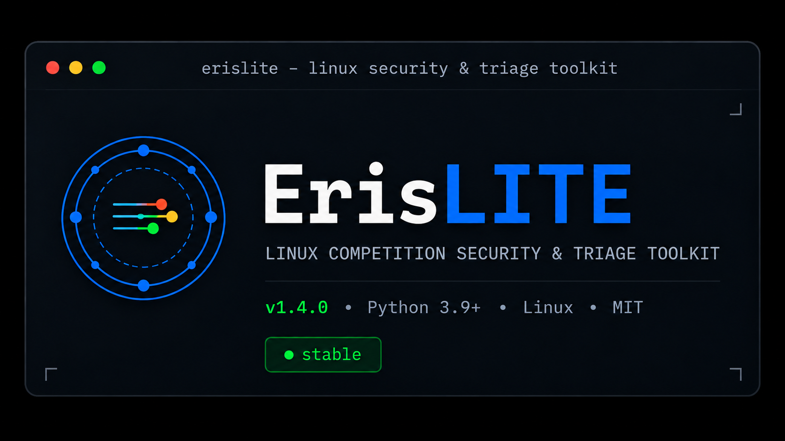

# ErisLITE

<p align="center">
  
</p>


*A modular Linux security monitoring and triage toolkit for analysts, students, and system administrators.*

ErisLITE is a standalone CLI toolkit for interactive security auditing, host triage, and competition-focused incident response on Linux systems.

Run threat sweeps, inspect system configuration, review historical findings, capture host snapshots, and perform rapid-response actions without requiring external infrastructure or cloud services.

ErisLITE is designed primarily for CCDC-style competition environments, cybersecurity students, analysts, and administrators who need fast, readable, local-first host visibility.

---

## Features

### Security Checks

| Module | What it checks |
|--------|----------------|
| Posture Snapshot | High-level security posture and host exposure |
| Network Listeners | Active TCP/UDP listeners with contextual risk classification |
| User Account Scan | UID anomalies, shell configuration, suspicious accounts |
| Login / Auth Logs | Failed logins, interactive root shells, recent login activity |
| Kernel Modules | Known-bad, unresolved, or unusually located kernel modules |
| File Integrity | Profile-specific SHA-256 baselines with incomplete-scan and expected-absence handling |
| World-Writable Files | Writable execution and persistence paths in sensitive locations |
| SUID / SGID | Unexpected privileged executables and risky locations |
| Cron / Timers | Suspicious cron jobs, periodic scripts, and systemd timer services |
| SSH Config Audit | Explicit `sshd_config` settings against the ErisLITE hardening baseline |
| SSH Key Check | Authorized key enumeration and privileged-account key review |
| Hosts Tamper Check | Suspicious `/etc/hosts` redirects and hostname mappings |
| Process Anomaly Scan | Suspicious execution paths, deleted binaries, and process indicators |
| Docker Security | Privileged containers, sensitive mounts, and Docker socket exposure |
| Firewall Status | UFW, firewalld, nftables, and iptables state |
| CVE Version Check | Built-in version rules for Dirty Pipe, Baron Samedit and Looney Tunables. Matches are reported as REVIEW and never scored |
| Backdoor Detection | Shell init, profile, and `LD_PRELOAD` persistence indicators |

### Threat Sweep

Threat Sweep combines selected modules into structured security profiles:

| Profile | Scope |
|---------|-------|
| `quick` | Listeners, users, authentication |
| `standard` | Integrity, listeners, users, authentication, CVE checks |
| `full` | Full host security and persistence assessment |

Threat Sweep provides:

- weighted risk scoring relative to the checks that ran (unsupported modules and the informational CVE check are excluded)
- per-module status and findings
- NEW, CHANGED, PERSISTING and RESOLVED findings compared with the previous sweep of the same profile
- per-module failure isolation, so one crashing check cannot lose the sweep
- threat tags with analyst-oriented explanations
- top risk contributors
- historical JSON logging
- full report viewing from previous sweeps
- analyst response guidance with investigation commands and recommendations

Risk is displayed relative to the checks that actually ran. For example:

```text
Score: 30/95
Rating: 32%
Risk Level: Moderate
```

### Odyssey Lite (Deception)

Odyssey Lite runs lightweight TCP canary listeners on ports that nothing legitimate should use. Any connection to a canary is recorded as an early-warning event: someone is scanning or probing the host.

Canaries accept a connection, record it and close it immediately. They never send data or emulate a service.

| Port | Decoy | Severity |
|------|-------|----------|
| 2121 | FTP (alternate) | Medium |
| 2222 | SSH (alternate) | High |
| 2323 | Telnet (alternate) | High |
| 3389 | RDP | High |
| 8080 | HTTP (alternate) | Medium |

Odyssey Lite provides:

- start and stop control from **Security Tools → Odyssey Lite**
- per-canary listener status
- a recent events view with source address, port, service and severity
- persistent JSONL event logging
- automatic labeling of its own canaries as `ErisLITE Canary` in Listener Check, so Threat Sweep does not count them as suspicious
- partial startup when one or more configured ports are unavailable
- duplicate suppression with repeat-summary persistence
- bounded in-memory event history
- callback failure isolation and listener resilience
- protected event-log storage with permission, ownership, symlink, and hard-link checks

### Additional Tools

| Tool | What it does |
|------|--------------|
| System Snapshot | Captures host, network, routing, and posture information to a timestamped log |
| Snapshot Log Viewer | Reviews previously captured system snapshots |
| Sweep Log Viewer | Browses recent Threat Sweeps and full per-module reports |
| SOC Mode | Repeated host posture collection for short-duration monitoring |
| Rapid Response | Triage, dry-run containment, per-action selection, firewall-aware IP blocking, cron quarantine, and rollback support |
| Shell Console | Restricted analyst console with hardened command resolution and execution controls |
| CVE Tools | Offline search of a CVE cache file you supply |

### CLI

- Interactive Rich-based terminal interface
- Section-grouped security tools
- Threat Sweep with `quick`, `standard`, and `full` profiles
- Weighted risk scoring relative to the checks executed
- Per-module findings and threat insights
- Historical Threat Sweep logging and report viewing
- System snapshot logging
- SOC Mode rolling posture collection
- Restricted Shell Console for analyst command execution
- Hardened command resolution and import validation for hostile environments
- Refuses to run as root from an install other accounts can modify
- Symlink-safe, private (0600) log and baseline writes
- Consistent `[ENTER] Return to menu` navigation

---

## Requirements

- Python 3.9+
- Linux (all security modules are Linux-only. Windows and macOS are not supported)
- `sudo` / root access recommended for full scan coverage
- Python packages: `rich`, `psutil`, `packaging`

---

## Installation

Install ErisLITE where only root can change it. When root runs ErisLITE, every module it imports runs as root, so a copy that an unprivileged account owns or can write is a privilege escalation path.

```bash
sudo git clone https://github.com/herrpeiper/ErisLITE.git /opt/erislite
sudo python3 -m venv /opt/erislite/.venv
sudo /opt/erislite/.venv/bin/pip install -r /opt/erislite/requirements.txt
```

The virtual environment avoids `externally-managed-environment` errors from `sudo pip` on current Debian and Ubuntu releases.

---

## Usage

```bash
sudo /opt/erislite/.venv/bin/python /opt/erislite/main.py
```

As root, ErisLITE checks the install before importing anything else. It refuses to start when:

- the install directory, any directory above it, `main.py`, `erislite/` or `data/` is owned by another account or writable by group or other users
- `PYTHONPATH` is set, `sys.path` includes a temporary directory, or an import directory is not root-controlled

It prints each problem and the commands to fix it. A clone under a home directory always fails this check, because the home directory belongs to the user. To accept the risk for one run, for example on a throwaway lab VM:

```bash
sudo python3 main.py --allow-unsafe-install
```

Non-root runs only show a warning.

Typical workflow:
1. Launch ErisLITE
2. Select **Security Tools** from the main menu
3. Run individual checks or select **Run Threat Sweep**
4. Review findings and risk score
5. Open **View Recent Threat Sweeps** to review past results

---

## Project Structure

```
ErisLITE/
│
├── erislite/
│   │
│   ├── accounts/
│   │   ├── profile.py
│   │   ├── login_audit.py
│   │   ├── users.py
│   │   ├── ssh_keys.py
│   │   └── ssh_config.py
│   │
│   ├── config/
│   │   ├── settings.py
│   │   └── theme.py
│   │
│   ├── containers/
│   │   └── docker.py
│   │
│   ├── deception/
│   │   └── odyssey/
│   │       ├── config.py
│   │       ├── events.py
│   │       ├── listeners.py
│   │       ├── manager.py
│   │       ├── menu.py
│   │       └── storage.py
│   │
│   ├── network/
│   │   ├── scan.py
│   │   ├── tools.py
│   │   ├── ports.py
│   │   ├── listeners.py
│   │   ├── firewall.py
│   │   └── hosts.py
│   │
│   ├── persistence/
│   │   ├── cron.py
│   │   ├── suid.py
│   │   ├── world_writable.py
│   │   └── backdoors.py
│   │
│   ├── response/
│   │   ├── guidance.py
│   │   ├── security_log.py
│   │   └── rapid_response/
│   │       ├── menu.py
│   │       ├── triage.py
│   │       ├── actions.py
│   │       ├── undo.py
│   │       └── utils.py
│   │
│   ├── security/
│   │   ├── command_resolver.py
│   │   ├── command_runner.py
│   │   ├── import_guard.py
│   │   ├── install_check.py
│   │   └── safe_io.py
│   │
│   ├── sweep/
│   │   ├── threat_sweep.py
│   │   ├── viewer.py
│   │   ├── snapshot.py
│   │   ├── log_viewer.py
│   │   └── soc_mode.py
│   │
│   ├── system/
│   │   ├── info.py
│   │   ├── processes.py
│   │   ├── kernel_modules.py
│   │   ├── integrity.py
│   │   └── security_audit.py
│   │
│   ├── ui/
│   │   ├── console.py
│   │   ├── utils.py
│   │   ├── splash.py
│   │   ├── cli.py
│   │   ├── shell_console.py
│   │   └── menus/
│   │       ├── security_menu.py
│   │       ├── network_menu.py
│   │       ├── system_menu.py
│   │       ├── cve_tools_menu.py
│   │       └── help_menu.py
│   │
│   ├── vulnerability/
│   │   ├── cve_checker.py
│   │   └── cve_tools.py
│   │
│   ├── data/                  # created at runtime
│   │   ├── user_profile.json
│   │   └── logs/odyssey/
│   │
│   ├── results.py
│   └── version.py
│
├── data/                      # created at runtime
│   ├── cve/                   # optional CVE cache you supply
│   ├── integrity/
│   ├── quarantine/rapid_response/
│   └── logs/
│       ├── threat_sweeps/
│       ├── soc_mode/
│       ├── network_connections/
│       ├── kernel_check/
│       └── rapid_response/
│
├── assets/
├── main.py
├── requirements.txt
├── CHANGELOG.md
├── LICENSE
└── README.md
```

---

## First Run Notes

**Integrity baseline** — File Integrity requires a baseline before it can detect changes. On first run, go to **Security Tools → File Integrity → Create Integrity Baseline** and choose the appropriate `critical`, `system`, or `user` profile. Runtime integrity data is stored under `data/integrity/` and is gitignored by design.

ErisLITE v1.4 keeps separate baselines per profile, records files that were expected to be absent when the baseline was created, distinguishes changed files from incomplete inspection, and reports collection/read failures instead of treating them as clean results. Protected files may require root privileges for complete coverage.

**User profile** — ErisLITE maintains user and host profile information used by portions of the CLI and snapshot tooling. The profile is stored at `erislite/data/user_profile.json`. The last sweep summary is stored under `~/.erislite/` of the effective user, which is `/root/.erislite/` under sudo.

**Root access** — some checks require elevated privileges for complete results, including authentication logs, kernel modules, SUID/SGID inspection, protected integrity targets, process inspection, and portions of persistence scanning. Run with `sudo` when full host coverage is required.

**CVE version checker** — compares the running kernel, sudo and glibc versions against built-in rules for CVE-2022-0847 (Dirty Pipe), CVE-2021-3156 (Baron Samedit) and CVE-2023-4911 (Looney Tunables). It does not use a CVE database. A version match does not confirm a vulnerability. Vendors frequently backport fixes without changing the upstream version string, so matches are reported as REVIEW and do not affect the risk score. Always verify findings against vendor advisories.

**CVE Tools search** — searches `data/cve/cve_cache.json`. ErisLITE does not ship or download this file. Supply a JSON list of records with `cve_id`, `description`, `severity` and optional `tags`.

**Threat Sweep history** — historical sweeps are stored under `data/logs/threat_sweeps/`. The latest sweep summary is also stored at `~/.erislite/last_sweep.json`.

**Odyssey Lite canaries** — canaries bind on all interfaces. Before starting Odyssey in a competition environment, confirm none of the default ports (2121, 2222, 2323, 3389, 8080) belong to a scored service. Ports 8080 and 3389 are the most likely conflicts. If a port is already in use, Odyssey starts the canaries it can and lists the unavailable ports. The status panel keeps showing them, and **Listener Status** marks them `FAILED`. Canaries run until you stop them or exit ErisLITE. Repeat connections from the same source to the same canary within 5 seconds are not logged as separate events. Instead, ErisLITE writes a `repeat_summary` record with the count and the first and last times seen when the window closes, when you stop Odyssey or when you clear events, so the log accounts for every connection. Events are written to `erislite/data/logs/odyssey/odyssey_events.jsonl`, which rotates at 5 MB and keeps three backups. ErisLITE refuses to write the log if the directory or file is a symlink, a hard link or owned by another user, and the status panel shows `Event log: FAILING` with the reason. **Clear Events** only clears the in-session view, not the log file.

**Rapid Response live mode** — Rapid Response includes dry-run and live containment actions. Live mode can modify system state, terminate processes, change firewall behavior, and perform other containment actions. Review dry-run output before executing live actions.

- Nothing runs until you select actions by number (for example `1,3-5` or `all`) and confirm.
- Only non-root accounts with UID 0 are offered for locking. System accounts with an interactive shell, such as `postgres` on Debian, are listed for review only. Sessions of an account that shares its UID with another account are never terminated by user, because `pkill -u` would hit the other account too.
- The operator's own account and SSH source address are never offered as targets.
- IP blocks are placed ahead of existing rules: `iptables -I OUTPUT 1` (and `ip6tables` for IPv6), `ufw insert 1`, a firewalld direct `OUTPUT` rule, or an `erislite` nftables table with address sets. ufw still accepts established sessions, so Rapid Response also offers to kill the shell or netcat process holding the connection.
- Removed cron files are quarantined under `data/quarantine/rapid_response/` with mode `0600`, outside every cron directory. Undo restores them without the world-writable bit.
- The response log is written after every action, so an interrupted run keeps its undo records. Undo refuses logs that another account could have edited.

If you used Rapid Response in 1.4 or earlier on a RHEL-family host, delete any `*.rr_backup_*` files left in `/etc/cron.d` and `/etc/cron.*`. cronie and run-parts can still execute them.

---

## Development

ErisLITE uses a domain-oriented package structure. New modules should be placed in the appropriate package under `erislite/`.

A security check should support structured non-interactive results built with `erislite.results.make_result()`:

```python
from erislite.results import make_result

def run_my_check(silent: bool = False) -> dict:
    return make_result("ok", details=[], tags=[])
```

Valid statuses are `ok`, `info`, `review`, `warning`, `issue`, `error` and `unsupported`. Only `warning`, `issue` and `error` add risk. `unsupported` modules are left out of the maximum score.

Write files through `erislite.security.safe_io` rather than `open()`, and run external commands through `erislite.security.command_runner.run_command()`.

Run the checks CI runs:

```bash
ruff check .
ruff format --check .
python -m pytest -q --cov=erislite --cov-fail-under=43
```
---

## License

MIT License — see `LICENSE` for details.

---

## Author

Liam Piper-Brandon (Stackdefender)

---

## Disclaimer

ErisLITE is intended for use on systems you own or have explicit written authorisation to audit. Unauthorised use against systems you do not own or have permission to test is illegal and unethical. The author accepts no responsibility for misuse.

The CVE version checker performs offline version matching only. A version match does not confirm a vulnerability — vendors frequently backport patches without changing the base version number. Do not treat a match as a confirmed finding without verifying against vendor advisories.

Rapid Response includes live containment functionality that can modify system state or disrupt services. Always review dry-run output first. Use live actions only on systems you are authorised to modify and only when you understand the actions being performed.

This software is provided as-is with no warranty of any kind. The author accepts no liability for damages, data loss, or service disruption resulting from its use.
